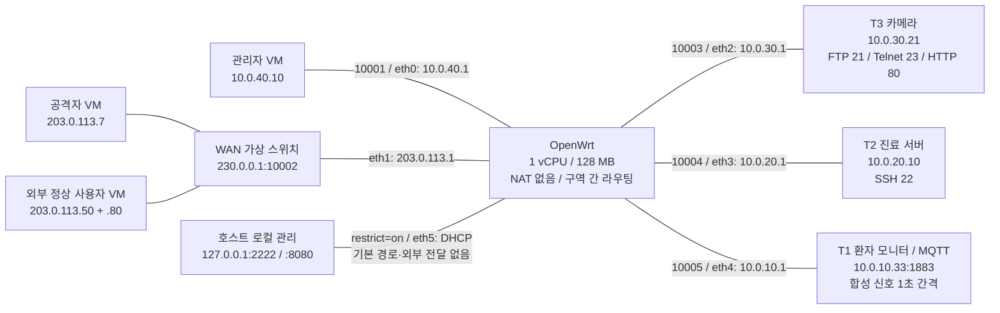

# WBS 4 실습망 구성도

각 연결은 WSL 내부의 루프백 멀티캐스트 가상 스위치다. 실제 NIC에 브리지하지 않는다.

- VM 6대: camera, server, monitor, admin, attacker, remote.
- 기기 기본 게이트웨이는 해당 구역의 OpenWrt 주소다.
- WAN에서 내부로 새로 시작하는 연결은 카메라 TCP 21·23·80만 허용한다.
- 관리자 VM은 카메라 합성 영상 파일을 5초마다 받으며 MQTT 신호를 구독한다.
- remote의 두 출발지 주소는 `curl --interface`와 `lftp set net:socket-bind-ip` 등으로 선택한다.
- 실행 중 서비스는 실습용이다. 이미지와 비밀번호는 Git에 올리지 않는다.
